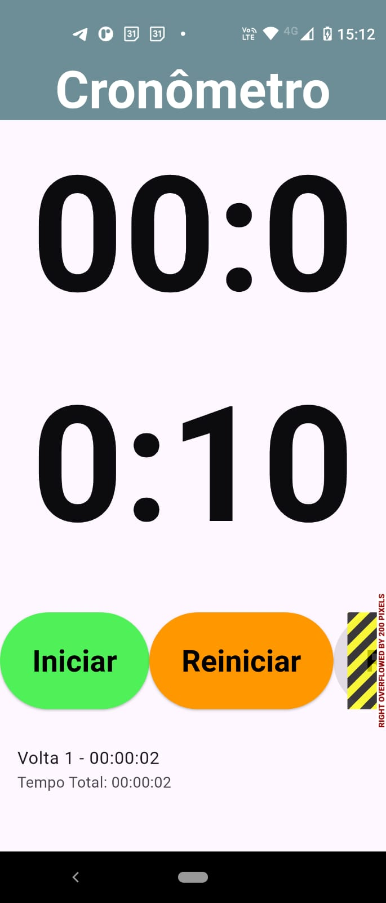
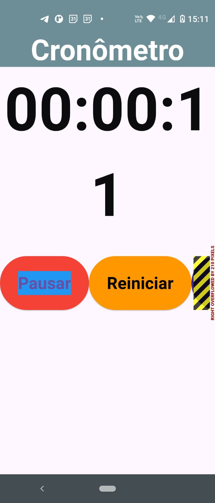
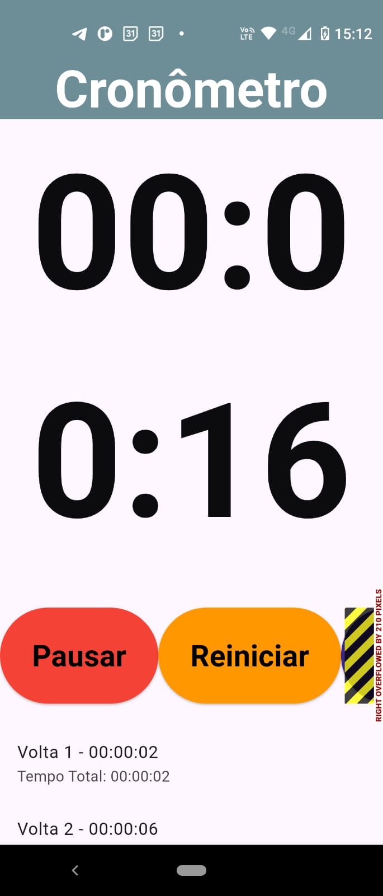

# Cronômetro de Voltas

Este aplicativo mobile foi desenvolvido utilizando o **padrão de arquitetura MVVM (Model-View-ViewModel)**, garantindo separação clara entre a interface, a lógica de apresentação e os dados. O app funciona como um **cronômetro de voltas**, oferecendo recursos de **acessibilidade** e **notificações** para melhor experiência do usuário.

O usuário pode **iniciar, pausar e reiniciar** o cronômetro, bem como **registrar várias voltas**. Cada volta registrada exibe o **tempo da volta** e o **tempo total decorrido**, organizados em uma lista dinâmica na interface, permitindo acompanhar facilmente o desempenho ao longo do tempo.  

Além disso, o aplicativo apresenta uma interface **intuitiva e responsiva**, adequada para diferentes tamanhos de tela, e inclui recursos de acessibilidade como **Semantics**, garantindo que usuários com necessidades especiais consigam interagir com o cronômetro de forma eficiente.

---

## Funcionalidades

- Iniciar cronômetro  
- Pausar cronômetro  
- Reiniciar cronômetro  
- Registrar voltas com tempo parcial e tempo total  
- Exibir todas as voltas registradas em uma lista dinâmica  

---

## Capturas de Tela

**Iniciar / Pausar / Parar:**

  
  

